# Aleksei Podolinnyi

Rust, agents, and knowledge tooling. Currently building **2brain** — a Rust knowledge engine over a typed
graph of notes with a fail-closed MCP write surface: <https://github.com/rager306/2brain>.

<!-- cool-readme:start -->
<!-- Cards by github-cool-readme: https://github.com/pedrocatalao/github-cool-readme -->

<picture>
  <source media="(prefers-color-scheme: dark)" srcset="https://raw.githubusercontent.com/rager306/rager306/cards/summary-dark.svg">
  
</picture>
<picture>
  <source media="(prefers-color-scheme: dark)" srcset="https://raw.githubusercontent.com/rager306/rager306/cards/languages-dark.svg">
  
</picture>

<picture>
  <source media="(prefers-color-scheme: dark)" srcset="https://raw.githubusercontent.com/rager306/rager306/cards/contributions-dark.svg">
  
</picture>
<picture>
  <source media="(prefers-color-scheme: dark)" srcset="https://raw.githubusercontent.com/rager306/rager306/cards/weekly-dark.svg">
  
</picture>

<!-- cool-readme:end -->
